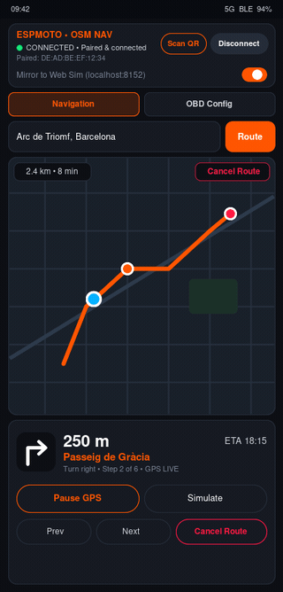
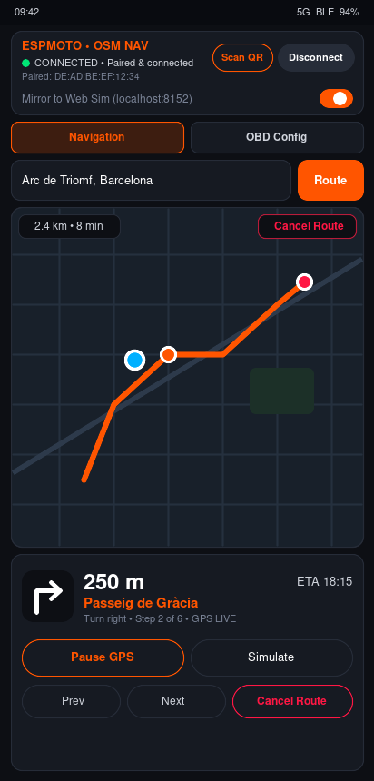
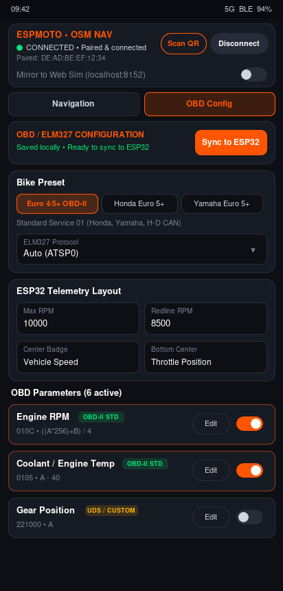
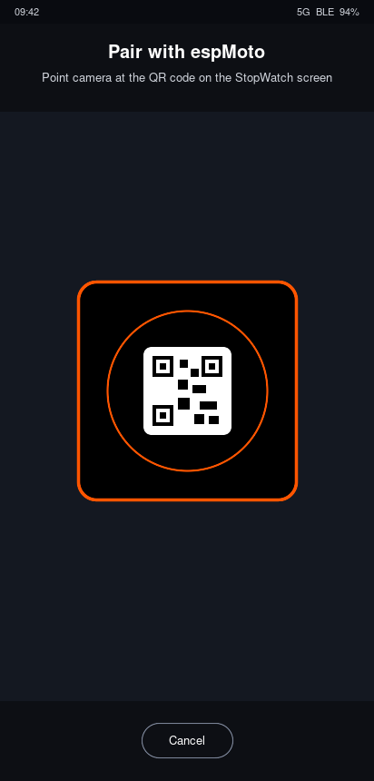

# espMoto Android Companion App

Kotlin + Jetpack Compose companion application for **espMoto** (M5Stack StopWatch C152 handlebar display). Provides self-contained OpenStreetMap turn-by-turn navigation, QR-based BLE pairing, and live OBD-II / ELM327 profile configuration over Bluetooth Low Energy.

<p align="center">
  
</p>

## Screenshots

| OpenStreetMap Navigation | OBD-II / ELM327 Configurator | QR Code BLE Pairing |
| :---: | :---: | :---: |
|  |  |  |

## Features
- **OpenStreetMap Search & Routing:** Geocodes destination addresses via public Nominatim, computes driving routes via OSRM, and previews routes on interactive `osmdroid` map tiles.
- **Share Intent Integration:** Accepts `geo:` URIs and shared Google Maps / location links directly from other apps (`ACTION_SEND`, `ACTION_VIEW`).
- **Background GPS Navigation:** Runs a foreground service (`OsmNavigationService`) with wake lock, off-route re-routing, and continuous BLE packet streaming even with the screen off.
- **QR Code BLE Pairing:** Scans the `espmoto://pair?mac=...&token=...` QR code on the StopWatch using CameraX + ML Kit and authenticates over BLE GATT.
- **Customizable OBD-II / ELM327 Configurator:** Includes presets (Euro 4/5+ Generic, Honda/Yamaha Euro 5+, Harley J1850 VPW & HDLAN CAN, or Custom), ELM327 BLE name filtering, tachometer max/redline RPM, display slot layout, and a custom PID hex/formula editor synced over BLE.
- **Helmet Sound Warnings & Developer Mode:** Optional Bluetooth helmet audio alerts with music ducking, plus a hidden Developer Mode (tap the version footer 7 times in **Preferences**) to enable offline GPS simulation and manual step controls.

## Building
1. Ensure Android SDK 35 and JDK 17 are installed (`local.properties` should point `sdk.dir` to your local Android SDK).
2. Build the debug APK:
   ```bash
   ./gradlew assembleDebug
   ```
   Output APK: `app/build/outputs/apk/debug/app-debug.apk`.

## Disclaimer
This is a **hobbyist project** created for personal experimentation and educational purposes:
- **Local Laws:** You are responsible for checking and complying with your local traffic and vehicle regulations regarding motorcycle navigation and handlebar-mounted displays.
- **OBD-II & Vehicle Risk:** Configuring custom OBD-II / UDS PIDs or connecting an ELM327 adapter to your motorcycle's diagnostic port is done entirely at your own risk. You are solely responsible for any electrical, ECU, or mechanical damage to your motorcycle.

## License
Licensed under the [MIT License](LICENSE).

